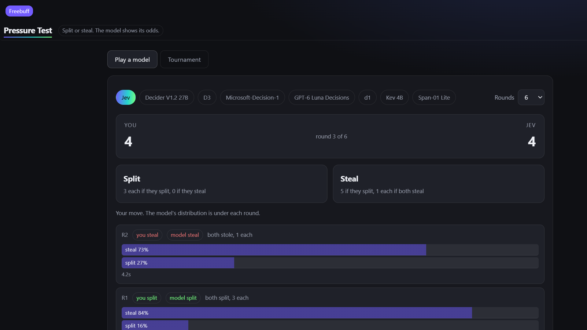

[](https://pollinations.ai/?ref=badge)

# Pressure Test

A game the decision models play. Split for a shared payout, or steal for a bigger one-sided one.
Live app: **https://rekty.github.io/pressure-test/**



Built for [quest #19176](https://github.com/pollinations/pollinations/issues/19176), the quest about a
game that AI models play.

## Why decision models

Pollinations serves eight models on `POST /alpha/decisions` (Jev, Perplexity's Decider, Microsoft
Decision, GPT-6 Luna Decisions, Kev, D1, D3, Span). They do not answer in prose: they answer with a
choice **and** a calibrated probability for every option. That makes them the right opponent for a
game of nerve, because the app can show the distribution it sampled from instead of a black-box
move. A 73% steal is visible as a 73% steal.

## Two ways to play

- **Play a model.** Six rounds, you move first each round. The model gets the rules, the score and
  the full history as `state`, and the question asks which move maximises its own total. Its answer
  is sampled from its own probabilities, so the game is genuinely stochastic in the way the model
  says it is. Each round prints the probabilities, the sampled move, the payoff and the latency.
- **Tournament.** Pick two to five models and every pair plays four rounds. Both models in a pair
  decide from the *same* history, before either move is revealed, so neither answers a move it has
  already seen. The board sums points and counts how often each model split or stole.

Payoffs: split/split 3–3, split/steal 0–5, steal/split 5–0, steal/steal 1–1.

## Paying for it

No backend, no key of the maintainer's. Readers connect through the device flow of
[Bring your own Pollen](https://github.com/pollinations/pollinations/blob/main/BRING_YOUR_OWN_POLLEN.md);
the token lives in that tab's `sessionStorage` and is only sent to `gen.pollinations.ai`. An `sk_`
key can be pasted instead. Every decision is one cheap call, and Jev bills input tokens only.

## Tests

```bash
node --test     # 7 tests
```

`shared/game.js` is pure and tested: the payoff matrix, sampling from a distribution (including a
400-draw check that a 0.75 steal really steals ~75% of the time), normalising an answer that only
carries probabilities, the `state` handed to the model (it must never contain an expected move),
round-robin fixtures and the scoreboard tally. The UI was exercised against the live
`/alpha/decisions` endpoint with a real device-flow session: play mode and a four-model tournament
(24 decisions) both completed.

## Run locally

```bash
python -m http.server 8091    # then open /pressure-test/
```

Files: `index.html`, `style.css`, `app.js`, `shared/pollen.js` (device flow + `/alpha/decisions`),
`shared/game.js` (rules), `test/game.test.mjs`.
